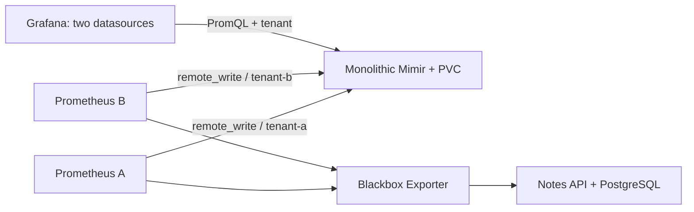

# Application metrics in Mimir

[Português](README.md)

The notes API already has a database and HTTP probes. This lab uses two Prometheus instances to observe those probes and send metrics into separate Grafana Mimir tenants. Grafana queries each tenant through its own datasource. We then interrupt services to check what is actually persisted and what can be resent.



Cluster `devops-sre` is separate from earlier environments. Its `notes-lab` and `mimir-lab` namespaces belong to this exercise. Earlier clusters need not run. We reuse the API and manifests from a pinned [kubernetes-lab revision](https://github.com/tommmdl/kubernetes-lab/tree/457f8b92a40c55aa05c2f3c75b8972c1c8f84ed4).

## Run

Use Linux x86_64 or WSL, Docker, Git, Bash, Python 3 and ripgrep. Clone this repository beside `kubernetes-lab`, at the revision recorded in `config/upstream.json`. Override the sibling path with `KUBERNETES_LAB_DIR` if needed.

```bash
# In kubernetes-lab, prepare local tools only:
bash scripts/prepare.sh

# In mimir-lab:
bash scripts/lab.sh up
python3 scripts/test.py
```

The script checks the sibling revision, creates only `devops-sre`, generates local passwords and deploys services. `.local/` holds kubeconfig/passwords, is Git-ignored and should be preserved while these volumes are used. This cluster has a new database; earlier lab data is not migrated.

## Inspect queries

```bash
bash scripts/access.sh grafana     # http://localhost:8026
bash scripts/access.sh mimir       # http://localhost:8025
bash scripts/access.sh prometheus  # http://localhost:8027
```

Each command occupies its terminal. Grafana user is `admin`; read the password in your own terminal with `cat .local/grafana-password`. Open **Notas no Mimir / Notes in Mimir**. Do not publish passwords, kubeconfig or `.local/` contents.

With the Mimir forward running:

```bash
curl -G -H 'X-Scope-OrgID: tenant-a' \
  --data-urlencode 'query=probe_success{job="notes-http"}' \
  http://127.0.0.1:8025/prometheus/api/v1/query
```

Change the header to `tenant-b` for the other dataset. `tenant_origin` is an identification label added by Prometheus; the header routes tenants, not that label. Queries missing the header receive 401. This **is not authentication**: direct API callers can choose another header. Services are ClusterIP and forwards bind only to `127.0.0.1`. Production needs a trusted authentication/authorization layer injecting tenant identity. Administrative endpoints such as `/config` do not necessarily require the same header as metric queries.

## Tested behavior

All **15 local checks passed**. Tests compare tenants, reject a missing tenant header, query through Grafana and inspect configured retention. For persistence, they stop Prometheus A, restart Mimir and query an earlier sample from that tenant before restarting the writer. This separates persistence from Prometheus replay.

They then scale only this cluster's API to zero, observe failed probes and restore two replicas. Finally, they stop Mimir, keep Prometheus scraping during a 25-second window, observe retries and check actual samples from that window after recovery. `count_over_time` counts samples inside the window; lookback repetition of an earlier value is not used as proof of backfill. A cleanup block restores replicas even after a failed check.

Tests manage forwards on ports 8025–8027. Close manual forwards first. `evidence/test-*.json` includes observations, code/config hashes and cleanup; failures generate separate reports. See [results and limitations](docs/validation.en.md).

## Limits

Mimir 3.2.3 runs monolithically with one replica, classic ingestion, replication factor 1 and filesystem storage on a PVC. There is no Kafka, external S3 storage, high availability or node-loss test. Restart checks recovery from local persisted state, not block recovery in another cluster.

Mimir retention is 24 hours; Prometheus retention is two hours. We inspect Mimir's active parameter but **did not wait 24 hours or validate physical deletion of expired blocks**. Replay was observed after a short interruption; it does not guarantee data preservation for every outage duration or PVC loss.

Metrics represent periodic API probes, not actual user-request rates, traffic percentiles or a production SLO. The later SLO project needs request instrumentation and an explicit denominator, window and exclusions.

Images are digest-pinned in `config/images.json`. `python3 scripts/render.py` generates versioned `manifests/stack.json`; Kustomize creates hashed ConfigMaps. Initial Mimir starts failed on writable paths outside the PVC; we corrected working directory/activity-file placement while retaining UID/GID 10001. Findings remain in [setup-findings.json](evidence/setup-findings.json). Scripts and documentation were prepared with assistant help and should be repeated and explained personally by the candidate.

## Stop and resume

```bash
bash scripts/lab.sh stop
bash scripts/lab.sh start
bash scripts/lab.sh status
```

These commands stop/start the node container, retaining volumes. Deleting the kind cluster removes local data and differs from stopping it. Tests close their forwards and leave the environment available.

References: [Mimir getting started](https://grafana.com/docs/mimir/latest/get-started/), [tenants and authentication](https://grafana.com/docs/mimir/latest/manage/secure/authentication-and-authorization/), [remote write](https://prometheus.io/docs/practices/remote_write/). Components retain their own licenses; no license is defined for original content.
