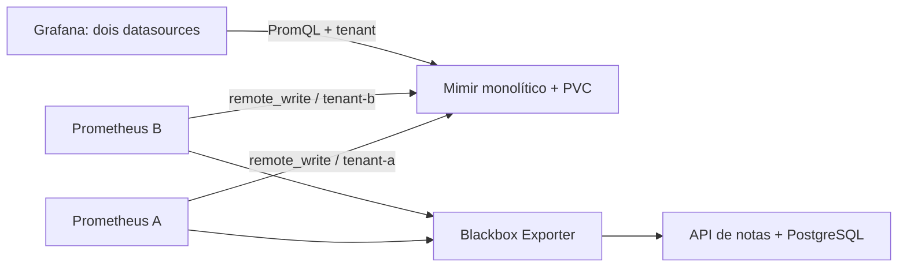

# Métricas da aplicação no Mimir

[English](README.en.md)

A API de notas já tem banco e sondas HTTP. Este lab acompanha essas sondas com dois Prometheus e envia as métricas para tenants diferentes no Grafana Mimir. O Grafana consulta cada tenant com um datasource próprio. Depois interrompemos serviços para conferir o que realmente fica guardado e o que consegue ser reenviado.



O cluster `devops-sre` é separado dos ambientes anteriores. Os namespaces `notes-lab` e `mimir-lab` deste cluster pertencem ao exercício. Nenhum cluster antigo precisa ser ligado. Reutilizamos a API e os manifestos da revisão fixada do [kubernetes-lab](https://github.com/tommmdl/kubernetes-lab/tree/457f8b92a40c55aa05c2f3c75b8972c1c8f84ed4).

## Executar

Use Linux x86_64 ou WSL, Docker, Git, Bash, Python 3 e ripgrep. Clone este repo ao lado de `kubernetes-lab`, na revisão indicada em `config/upstream.json`. Se precisar de outro caminho, defina `KUBERNETES_LAB_DIR`.

```bash
# No kubernetes-lab, prepara somente os binários locais:
bash scripts/prepare.sh

# No mimir-lab:
bash scripts/lab.sh up
python3 scripts/test.py
```

O script confirma a revisão do projeto vizinho, cria somente o cluster `devops-sre`, gera senhas locais e aplica os serviços. `.local/` contém kubeconfig e senhas, fica ignorado pelo Git e deve ser preservado enquanto os volumes forem usados. O banco deste cluster é novo: não há migração dos dados dos labs antigos.

## Ver as consultas

```bash
bash scripts/access.sh grafana     # http://localhost:8026
bash scripts/access.sh mimir       # http://localhost:8025
bash scripts/access.sh prometheus  # http://localhost:8027
```

Cada comando ocupa seu terminal. No Grafana, o usuário é `admin`; consulte a senha no seu terminal com `cat .local/grafana-password`. Abra o dashboard **Notas no Mimir / Notes in Mimir**. Não publique senhas, kubeconfig ou o conteúdo de `.local/`.

Com o acesso do Mimir aberto:

```bash
curl -G -H 'X-Scope-OrgID: tenant-a' \
  --data-urlencode 'query=probe_success{job="notes-http"}' \
  http://127.0.0.1:8025/prometheus/api/v1/query
```

Troque o header por `tenant-b` para consultar o outro conjunto. `tenant_origin` é um label de identificação acrescentado pelo Prometheus; o roteamento do tenant é feito pelo header, não pelo label. A consulta sem header recebe 401. Isso **não é autenticação**: quem acessa a API diretamente pode escolher outro header. Serviços são ClusterIP e os acessos locais usam somente `127.0.0.1`. Produção exige uma camada confiável de autenticação/autorização e injeção do tenant. Endpoints administrativos, como `/config`, não têm necessariamente a mesma exigência de header das consultas.

## O que foi testado

As **15 verificações locais passaram**. O teste compara os dois tenants, rejeita a consulta sem header, consulta pelo Grafana e confere a retenção configurada. Para testar persistência, para o Prometheus A, reinicia o Mimir e consulta uma amostra histórica desse tenant antes de religar o escritor. Isso evita confundir persistência com reenvio do Prometheus.

Depois reduz somente a API deste cluster a zero réplicas, espera sondas com falha e restaura duas réplicas. Por fim, para o Mimir, mantém os Prometheus coletando durante uma janela de 25 segundos, observa tentativas de reenvio e verifica amostras reais dessa janela após a recuperação. `count_over_time` conta amostras dentro da janela; não usamos repetição de um valor antigo por lookback como prova de backfill. As réplicas são restauradas em um bloco de limpeza, inclusive se uma checagem falhar.

O teste abre seus próprios port-forwards nas portas 8025–8027. Feche os acessos manuais antes de executá-lo. Relatórios em `evidence/test-*.json` incluem observações, hashes de código/configuração e limpeza; falhas geram um relatório separado. Veja os [resultados e limitações](docs/validation.md).

## O que este ambiente não comprova

Mimir 3.2.3 roda em modo monolítico, com uma réplica, ingestão clássica, fator de replicação 1 e armazenamento filesystem no PVC. Não há Kafka, armazenamento S3 externo, alta disponibilidade ou teste de perda do nó. O reinício confere recuperação do histórico local via estado persistido; não prova recuperação de blocos em outro cluster.

A retenção do Mimir está em 24 horas e a do Prometheus em duas horas. Conferimos o parâmetro ativo no Mimir, mas **não esperamos 24 horas nem validamos a exclusão física de blocos expirados**. O reenvio foi observado em uma interrupção curta; não promete preservar dados em qualquer duração de indisponibilidade ou perda de PVC.

As métricas representam sondas periódicas da API. Não são taxas de requisições reais dos usuários, percentis de tráfego nem um SLO de produção. O próximo projeto de SLO precisa instrumentar requisições e declarar denominador, janela e exclusões.

As imagens estão fixadas por digest em `config/images.json`. Os manifestos são gerados por `python3 scripts/render.py` e versionados em `manifests/stack.json`; o Kustomize cria ConfigMaps com hash. Inicialmente o Mimir falhou por caminhos graváveis fora do PVC; corrigimos o diretório de trabalho e o arquivo de atividades, mantendo UID/GID 10001. Esses achados estão em [setup-findings.json](evidence/setup-findings.json). Os scripts e a documentação foram preparados com ajuda do assistente e precisam ser repetidos e explicados pessoalmente pelo candidato.

## Parar e continuar depois

```bash
bash scripts/lab.sh stop
bash scripts/lab.sh start
bash scripts/lab.sh status
```

Esses comandos param/iniciam o container do nó e mantêm volumes. Apagar o cluster kind remove os dados locais; não é o mesmo que parar. Os testes encerram seus próprios acessos, mas deixam o ambiente disponível.

Referências: [início com Mimir](https://grafana.com/docs/mimir/latest/get-started/), [tenants e autenticação](https://grafana.com/docs/mimir/latest/manage/secure/authentication-and-authorization/), [remote write](https://prometheus.io/docs/practices/remote_write/). As licenças dos componentes são independentes; não há licença definida para o conteúdo próprio.
